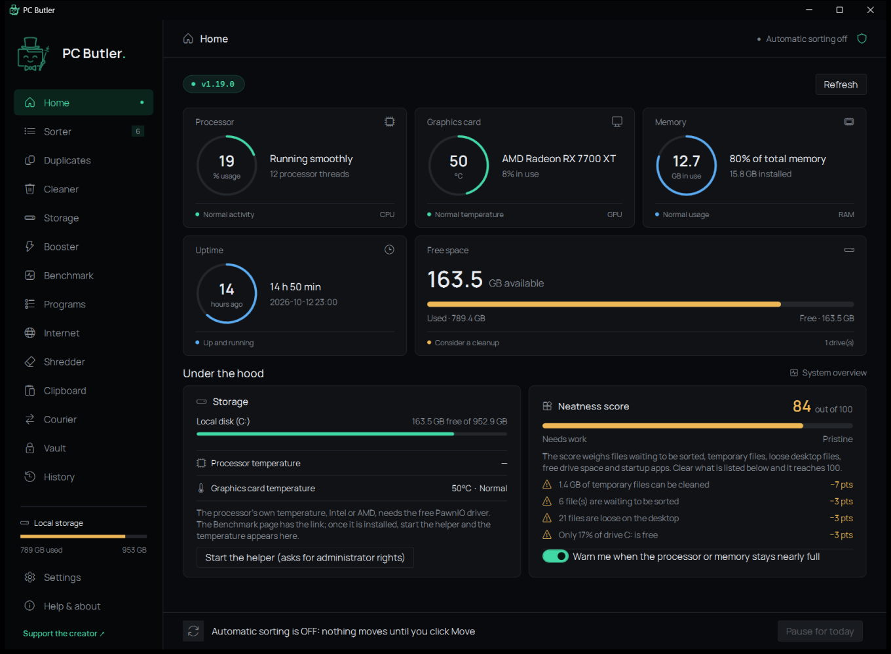
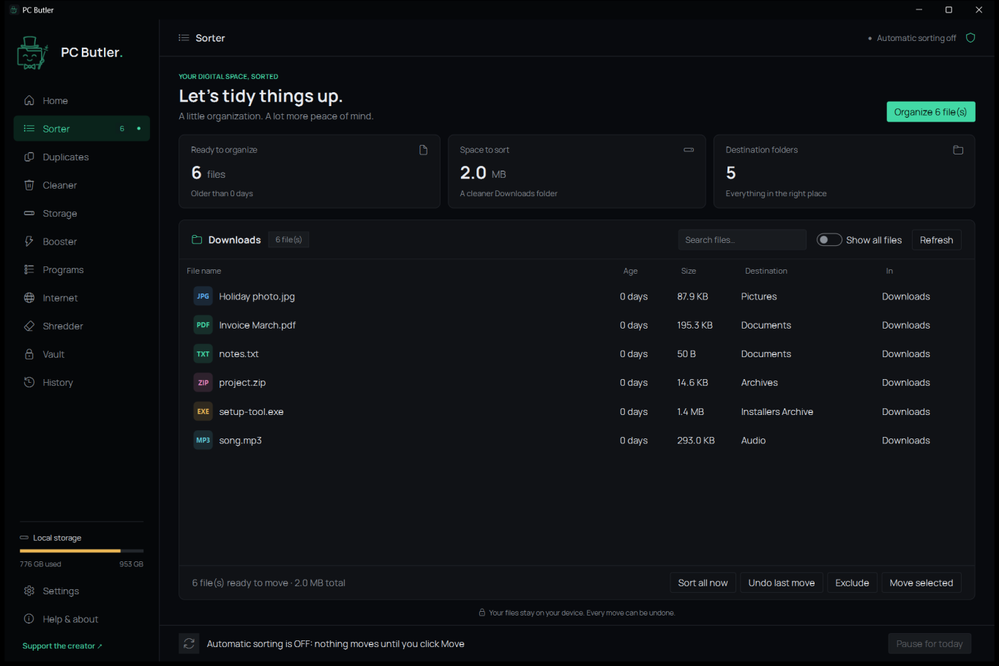

# PC Butler

**English** | [العربية](#العربية)

A small Windows program that keeps your PC tidy. It moves files that have been sitting in your Downloads folder for a while into category folders (Documents, Pictures, Videos…), either automatically in the background or only when you say so, and every change is logged and can be undone. It also finds duplicate files, cleans junk files, shows what fills your drives, trims startup apps, uninstalls and updates programs, measures your internet speed and keeps private files in an encrypted vault.

PC Butler is the C# rewrite of [Downloads Sorter](https://github.com/hmodymac8-droid/downloads-sorter), with the same look and everything it could do, plus the pages added since. On first start it brings along Downloads Sorter's settings, history and vault (it copies them; the old program keeps working).





## Features

- **Home.** The PC at a glance: processor, memory and graphics-card use, the graphics card's temperature, free space on every drive, and a neatness score out of 100 with the reasons it lost points. The tray icon shows processor and memory use and warns when they stay nearly full.
- **Sorts by age and type.** Files older than a set number of days (7 by default) move into category folders by file extension. Each category can have its own age.
- **Preview first.** See exactly which files will move and where before anything happens, and exclude the ones you want to keep.
- **Automatic mode.** Runs in the background with a tray icon, checks on a schedule (every so many minutes, daily or weekly at a time you set), and starts when you sign in. Cleaning can be scheduled the same way. After each run a report window lets you approve or undo what moved.
- **Full history with undo.** Every move and deletion is logged. Put back any files you choose; deleted files are restored from the Recycle Bin. The log can be cleared with one button; no file is touched.
- **Duplicate finder.** Looks in the sorted folders or any folder you pick and finds copies by identical content, exact name, name and size, size, or a *similar name* (messy song and video titles are matched as the same file). Tick files one by one or with quick picks, then choose whether they go to the Recycle Bin or are deleted for good.
- **Cleaner.** Finds temporary files, browser caches, crash reports and other junk, and can clear traces such as the recent-files list. Nothing is deleted until you click Clean, and everything cleaned is listed in History.
- **Storage.** A map of what fills a folder or a drive, and a list of large files that have not been touched for a long time.
- **Booster.** Turns startup apps off and on (they stay installed), ends programs that use a lot of memory, and switches the power plan. Boost gives one program the PC's attention (high priority for it, lower for the background, high-performance power plan) and puts everything back when switched off; it can switch on by itself while chosen programs run. Optionally it also trims the memory of background programs and pauses three Windows services (see *Administrator rights* below).
- **Programs.** Every installed program in one list, with the drive it is on and a filter by drive; double-click one to open it. Uninstall runs the program's own uninstaller and then shows what it left behind (folders, shortcuts, its own registry key) for you to tick: folders go to the Recycle Bin, registry keys are saved to a `.reg` file first. Updates come from winget, Windows' package manager.
- **Internet.** A speed test: download, upload and response time, measured against Cloudflare's speed-test servers, with a history of earlier results.
- **Vault.** Password-protected storage: files you add are encrypted (AES-256) and removed from where they were.
- **Auto clean-up.** Optionally recycle old files in a category (for example installers after 90 days). Only files the program itself moved are touched.
- **Never-move list.** Protect files by name or pattern (`*.torrent`). Files you put back with Undo are not moved again automatically.
- **Several folders.** Sort Desktop or any other folder with the same rules.
- **File Explorer menu.** Right-click a file or folder and choose *Process with PC Butler* to sort it, sort a folder's loose files, or send a file to the Recycle Bin without opening the program. On Windows 11 the entry is under *Show more options*.
- **What's new.** After each update a window lists what changed; the full list is in [CHANGELOG.md](CHANGELOG.md).
- **English and Arabic.** The interface follows Windows' language, or you pick one in Settings.
- **Updates.** Checks this repository's releases, notifies you when a new version is out, and updates with one click (or automatically, if you turn that on).
- **Safe by design.** Unfinished downloads and shortcuts are skipped, nothing is ever overwritten, and deletions go to the Recycle Bin unless you choose to delete for good.

## Administrator rights

PC Butler never runs as administrator. The graphics card's temperature needs no special rights. A processor's own temperature can only be read by a hardware-monitor driver, which PC Butler does not install; if LibreHardwareMonitor is running, PC Butler shows its readings. Two things need administrator rights, and both are optional: reading the motherboard's temperature and fan sensors (Home page), and pausing services while Boost is on. For those, PC Butler starts a small helper, a second copy of itself, only when you ask and only after Windows' permission prompt. The helper can read the sensors and pause or resume three named services (Print Spooler, Connected User Experiences and Telemetry, SysMain), nothing else, and it resumes them and ends when PC Butler closes.

## Install

Download `PCButlerSetup.exe` from the [Releases](../../releases) page and run it. It installs for your user account only and needs no administrator rights. The installer is not code-signed, so Windows SmartScreen may warn you: click **More info**, then **Run anyway**.

## Build

Requires Windows 10/11 and the [.NET 10 SDK](https://dotnet.microsoft.com/download).

```
dotnet build src/PCButler
dotnet run --project tests/PCButler.Tests
```

The first builds the program (`src/PCButler/bin/Debug/net10.0-windows/PCButler.exe`), the second runs the engine's tests.

## Build the installer

Also requires [Inno Setup 6](https://jrsoftware.org/isinfo.php) (`winget install JRSoftware.InnoSetup`).

```
./build.ps1
```

This publishes the program with the .NET runtime included (nothing else is needed on the user's PC) and produces `PCButlerSetup.exe`, a standard Windows setup wizard in English and Arabic, next to the script.

## How it works

| Folder or file | Purpose |
|---|---|
| `src/PCButler.Core` | The engine: settings, rules, moving, history, undo, Recycle Bin, duplicates, cleaner, storage, booster and Boost, the administrator helper, installed programs, speed test, vault, updates and the background loop |
| `src/PCButler` | The windows (WPF): control panel, tray icon, report window, launch screen |
| `tests/PCButler.Tests` | Tests of the engine |
| `installer/installer.iss` | The setup wizard (Inno Setup script) |
| `build.ps1` | Publishes the program and compiles the setup wizard |

Settings, the history log, the activity log and registry backups are stored in `%APPDATA%\PCButler`.

The speed test talks to `speed.cloudflare.com` and update checks talk to GitHub and winget's source. Nothing else leaves the PC.

## License

Copyright (c) 2026 hmodymac8-droid.

Released under the [GNU General Public License, version 3](LICENSE). You are free to use, change and share it, including commercially, but any version you distribute must keep this copyright notice, say what you changed, and come with its full source code under the same license.

The bundled fonts in `src/PCButler/Fonts`, [DM Sans](https://github.com/googlefonts/dm-fonts) and [Manrope](https://github.com/googlefonts/manrope), are under the SIL Open Font License; their licence texts are next to them.

---

<div dir="rtl">

## العربية

[English](#pc-butler) | **العربية**

برنامج صغير لنظام ويندوز يحافظ على ترتيب جهازك. ينقل الملفات التي بقيت في مجلد التنزيلات لفترة إلى مجلدات مصنّفة (مستندات، صور، فيديو…)، إما تلقائيًا في الخلفية أو فقط عندما تطلب ذلك، وكل تغيير يُسجَّل ويمكن التراجع عنه. كما يعثر على الملفات المكررة، وينظّف الملفات غير الضرورية، ويعرض ما يملأ أقراصك، ويخفّف برامج بدء التشغيل، ويلغي تثبيت البرامج ويحدّثها، ويقيس سرعة الإنترنت، ويحفظ الملفات الخاصة في خزنة مشفّرة.

PC Butler هو إعادة كتابة لبرنامج [Downloads Sorter](https://github.com/hmodymac8-droid/downloads-sorter) بلغة C#، بالشكل نفسه وبكل ما كان يفعله، مع الصفحات التي أُضيفت بعده. عند أول تشغيل ينسخ إعدادات Downloads Sorter وسجله وخزنته (نسخًا، فيبقى البرنامج القديم يعمل).

### المميزات

- **الرئيسية.** جهازك في لمحة: استهلاك المعالج والذاكرة وكرت الشاشة، وحرارة كرت الشاشة، والمساحة الحرة في كل قرص، ونقاط ترتيب من 100 مع أسباب الخصم. أيقونة البرنامج بجانب الساعة تعرض استهلاك المعالج والذاكرة وتنبّه عند امتلائهما المستمر.
- **الفرز حسب العمر والنوع.** الملفات الأقدم من عدد محدد من الأيام (7 افتراضيًا) تُنقل إلى مجلدات التصنيف حسب امتداد الملف، ويمكن تحديد عمر مختلف لكل تصنيف.
- **المعاينة أولًا.** شاهد الملفات التي ستُنقل ووجهتها قبل أي تنفيذ، واستثنِ ما تريد إبقاءه.
- **الوضع التلقائي.** يعمل في الخلفية مع أيقونة بجانب الساعة، ويفحص المجلد وفق جدول زمني (كل عدد من الدقائق، أو يوميًا أو أسبوعيًا في وقت تحدده)، ويبدأ مع تسجيل الدخول. ويمكن جدولة التنظيف بالطريقة نفسها. بعد كل عملية تظهر نافذة تقرير للموافقة على ما نُقل أو التراجع عنه.
- **سجل كامل مع إمكانية التراجع.** كل عملية نقل أو حذف تُسجَّل. يمكنك إعادة أي ملفات تختارها، والملفات المحذوفة تُستعاد من سلة المحذوفات. ويمكن مسح السجل بزر واحد دون المساس بأي ملف.
- **كاشف الملفات المكررة.** يبحث في المجلدات المرتّبة أو في أي مجلد تختاره، ويعثر على النسخ المكررة حسب المحتوى المتطابق، أو الاسم نفسه، أو الاسم والحجم، أو الحجم، أو *الاسم المتشابه* (عناوين الأغاني والفيديو الفوضوية تُعتبر الملف نفسه). حدّد الملفات واحدًا واحدًا أو باختيارات سريعة، ثم اختر: إلى سلة المحذوفات أو حذف نهائي.
- **المنظّف.** يعثر على الملفات المؤقتة وذاكرة المتصفحات المؤقتة وتقارير الأعطال وغيرها، ويمسح آثارًا مثل قائمة الملفات الأخيرة. لا يُحذف شيء حتى تضغط «تنظيف»، وكل ما يُنظَّف يظهر في السجل.
- **التخزين.** خريطة لما يملأ مجلدًا أو قرصًا، وقائمة بالملفات الكبيرة التي لم تُستخدم منذ مدة طويلة.
- **المسرّع.** يوقف برامج بدء التشغيل أو يشغّلها (تبقى مثبّتة)، وينهي البرامج التي تستهلك الكثير من الذاكرة، ويبدّل خطة الطاقة. «التعزيز» يعطي برنامجًا واحدًا تركيز الجهاز (أولوية عالية له، وأقل لبرامج الخلفية، وخطة طاقة الأداء العالي) ويعيد كل شيء عند إيقافه، ويمكنه أن يشتغل تلقائيًا ما دامت برامج تختارها تعمل. واختياريًا يفرّغ ذاكرة برامج الخلفية ويوقف ثلاث خدمات من ويندوز مؤقتًا (انظر «صلاحيات المسؤول» أدناه).
- **البرامج.** كل البرامج المثبّتة في قائمة واحدة، مع القرص الذي عليه كل برنامج وفلتر حسب القرص، والنقر المزدوج يفتح البرنامج. إلغاء التثبيت يشغّل برنامج الإزالة الخاص بالبرنامج ثم يعرض ما تركه خلفه (مجلدات، اختصارات، مفتاحه في السجل) لتختار منه: المجلدات تذهب إلى سلة المحذوفات، ومفاتيح السجل تُحفظ أولًا في ملف `.reg`. التحديثات تأتي من winget، مدير الحزم الخاص بويندوز.
- **الإنترنت.** قياس السرعة: التنزيل والرفع وزمن الاستجابة، مقابل خوادم Cloudflare لقياس السرعة، مع سجل للنتائج السابقة.
- **الخزنة.** مساحة محمية بكلمة مرور: الملفات التي تضيفها تُشفَّر (AES-256) وتُزال من مكانها الأصلي.
- **التنظيف التلقائي.** خيار لإرسال الملفات القديمة في تصنيف معيّن إلى سلة المحذوفات (مثل ملفات التثبيت بعد 90 يومًا). لا يمسّ إلا الملفات التي نقلها البرنامج نفسه.
- **قائمة «لا تنقل أبدًا».** احمِ ملفات معيّنة بالاسم أو بالنمط (مثل `*.torrent`). الملفات التي أعدتها بالتراجع لا تُنقل تلقائيًا مرة أخرى.
- **عدة مجلدات.** افرز سطح المكتب أو أي مجلد آخر بالقواعد نفسها.
- **قائمة File Explorer.** انقر بالزر الأيمن على ملف أو مجلد واختر «معالجة بـ PC Butler» لفرزه، أو فرز الملفات السائبة في المجلد، أو إرسال الملف إلى سلة المحذوفات دون فتح البرنامج. في ويندوز 11 تجد الخيار تحت *Show more options*.
- **ما الجديد.** بعد كل تحديث تظهر نافذة بما تغيّر، والقائمة الكاملة في [CHANGELOG.ar.md](CHANGELOG.ar.md).
- **العربية والإنجليزية.** الواجهة تتبع لغة ويندوز، أو تختار اللغة من الإعدادات.
- **التحديثات.** يتحقق من إصدارات هذا المستودع، وينبّهك عند صدور نسخة جديدة، ويحدّث نفسه بضغطة واحدة (أو تلقائيًا إذا فعّلت ذلك).
- **آمن في تصميمه.** يتجاوز التنزيلات غير المكتملة والاختصارات، ولا يستبدل أي ملف موجود، والحذف يكون إلى سلة المحذوفات إلا إذا اخترت الحذف النهائي.

### صلاحيات المسؤول

PC Butler لا يعمل أبدًا بصلاحيات المسؤول. حرارة كرت الشاشة لا تحتاج أي صلاحيات. أما حرارة المعالج نفسه فلا يقرؤها إلا تعريف (driver) لمراقبة العتاد و PC Butler لا يثبّت تعريفات؛ إذا كان LibreHardwareMonitor يعمل يعرض PC Butler قراءاته. أمران فقط يحتاجان صلاحيات المسؤول وكلاهما اختياري: قراءة حساسات اللوحة الأم للحرارة والمراوح (الصفحة الرئيسية)، وإيقاف الخدمات مؤقتًا أثناء التعزيز. لهما يشغّل PC Butler مساعدًا صغيرًا، نسخة ثانية منه، فقط عندما تطلب وبعد موافقتك على نافذة ويندوز. المساعد يقرأ الحساسات ويوقف أو يشغّل ثلاث خدمات محددة (Print Spooler و Connected User Experiences and Telemetry و SysMain) ولا شيء غيرها، ويعيد تشغيلها وينتهي عند إغلاق PC Butler.

### التثبيت

نزّل الملف `PCButlerSetup.exe` من صفحة [الإصدارات](../../releases) وشغّله. يُثبَّت البرنامج لحساب المستخدم الحالي فقط ولا يحتاج إلى صلاحيات المسؤول. ملف التثبيت غير موقّع رقميًا، لذلك قد يعرض ويندوز تحذير SmartScreen: اضغط **More info** ثم **Run anyway**.

### البناء من الشيفرة المصدرية

يتطلب ويندوز 10 أو 11 و[.NET 10 SDK](https://dotnet.microsoft.com/download).

</div>

```
dotnet build src/PCButler
dotnet run --project tests/PCButler.Tests
```

<div dir="rtl">

### بناء ملف التثبيت

يتطلب أيضًا [Inno Setup 6](https://jrsoftware.org/isinfo.php) (`winget install JRSoftware.InnoSetup`).

</div>

```
./build.ps1
```

<div dir="rtl">

ينتج عن ذلك الملف `PCButlerSetup.exe`، وهو معالج تثبيت ويندوز قياسي بالعربية والإنجليزية، ويتضمن بيئة ‎.NET فلا يحتاج جهاز المستخدم إلى أي شيء آخر.

### أين تُحفظ البيانات

الإعدادات وسجل التغييرات وسجل النشاط تُحفظ في المجلد `%APPDATA%\PCButler`.

### الترخيص

حقوق النشر (c) 2026 hmodymac8-droid.

البرنامج منشور بموجب [رخصة جنو العمومية، الإصدار 3](LICENSE). يحق لك استخدامه وتعديله ومشاركته، حتى تجاريًا، بشرط أن تُبقي أي نسخة توزّعها على إشعار حقوق النشر هذا، وأن توضّح ما غيّرته، وأن ترفق شيفرتها المصدرية كاملة بالرخصة نفسها.

</div>
